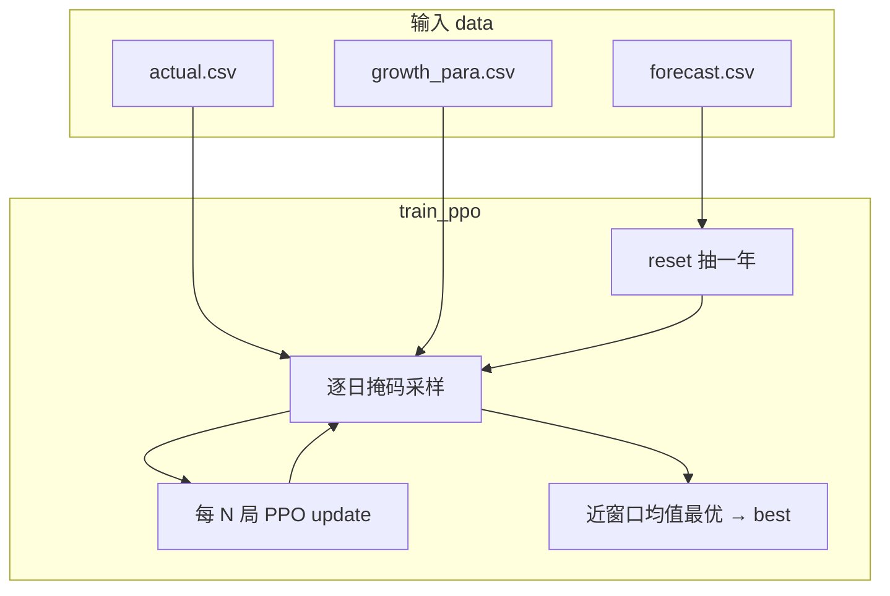

# 一期：强化学习训练与建模说明

> 对应代码：`train/PPO_Rice_env.py`、`train/PPO_RL_brain.py`、`train/ppo_model.py`  
> 决策后处理：`decision/`（推理/评估用；训练主要靠掩码 + `env.correct`）  
> 情景参数：`configs/scenario.json`（见 `场景与输出.md`）  
> 产物目录：`output/runs/run_<ts>/`（见 `场景与输出.md`）

---

## 1. 问题怎么建成 MDP

| 要素 | 本项目定义 |
|---|---|
| 智能体 | PPO 策略网络（Actor-Critic 一体） |
| 环境 | 单田块逐日水层管理（晚稻生育季） |
| 决策时点 | 每天一次灌/排/不动 |
| 回合 (episode) | 随机抽一年，从生育期首日滚到末日（或 max 200 步） |
| 目标 | 在节水、产量（水分胁迫）、涝渍约束下学到灌排策略 |

---

## 2. 状态 $s_t$（8 维）

网络输入（`process_series` 去掉 date / h_after / p 后）：

| 维 | 符号 | 含义 |
|---|---|---|
| 0 | $h$ | 当日决策前田面水层 mm（负值=亏缺） |
| 1 | $h_{\min}$ | 适宜下限 |
| 2 | $h_{\max}$ | 适宜上限（灌水封顶） |
| 3 | $H_p$ | 排水目标/控制水位 |
| 4 | $H_c$ | 耐淹上限 |
| 5 | $\lambda$ | 该生育阶段产量对水分敏感指数 |
| 6 | $k_s$ | 水分胁迫系数（由 $h$ 与 RAW/TAW 算） |
| 7 | $P_{\mathrm{cumu7}}$ | 未来 7 日累计预报雨量 |

土壤参数来自 `scenario.json`（默认 $RAW=16\,\mathrm{mm}$，$TAW=80\,\mathrm{mm}$），实现见 `common.scenario.ks_factor`。

$$
k_s =
\begin{cases}
1, & h > -RAW \\
\dfrac{TAW + h}{TAW - RAW}, & \text{否则（再夹到 }[0,1]\text{）}
\end{cases}
$$

---

## 3. 动作 $a_t$（21 档离散）

$$
\mathcal{A}=\{-100,-90,\ldots,-10,0,10,\ldots,100\}\quad(\mathrm{mm})
$$

- $a>0$：计划灌溉  
- $a<0$：计划排水  
- $a=0$：不动  

**动作掩码**（一期封装版训练/推理默认同开）：按 $h,h_{\max},H_p,H_c$ 关掉非法档（如 $h\ge H_c$ 只留 $-100$；超 $h_{\max}$ 不许灌等）。详见 `common/action_mask.py`。

执行时环境 `correct` 再物理限幅：灌不超过 $h_{\max}$，排不低于 $H_p$。

---

## 4. 状态转移（水量平衡）

### 4.1 一步执行

1. 智能体给出 $a_t$（训练：掩码后采样；推理：掩码 argmax + 可选守卫）。  
2. `correct`：得到实际执行量 $a^{\mathrm{exec}}$，并更新决策后水层 $h'$。  
3. 气象驱动：

$$
h_{t+1}^{\mathrm{before}}
= h' + P_{1,a} - ET_{\mathrm{eff}} - p
$$

其中：

- $P_{1,a}$：当日实测降雨  
- 若 $h'\le 0$ 且亏缺深，ET 先按 $k_s$ 折减  
- 渗漏 $p$：有田面水时常取当日 `p` 列（约 1.5 mm/d），无水为 0  

次日状态行来自 `forecast` 表（阶段参数、$P_{\mathrm{cumu7}}$ 等），仅 `h_before` 由上式写入。

### 4.2 转移示意

```text
        a_t (离散 mm)
s_t ──────────────────► correct(限幅) ──► h'
 │                                         │
 │                                         ▼
 │                              +P − ET_eff − p
 │                                         │
 └──── 查次日阶段参数 ◄────────────────────┘
                    s_{t+1}
```

这不是「状态转移矩阵」表格（连续水位+高维气象，状态空间过大），而是 **转移核 $P(s'|s,a)$** 由确定性水量平衡 + 给定气象序列实现。评估/训练用的是历史年气象轨迹，属 **仿真 MDP**。

### 4.3 季初

训练 `reset` / 评估 `reset_policy`：首日 $h \leftarrow h_{\max}$（适灌带上沿）。  
`scenario.calendar.start/terminal` **必须**与 **每一年** forecast/actual 的季内逐日一致（含首尾；开跑前 `validate_scenario_data` 全检）。  
`duration_days`：奖励 7 日前瞻在季末缩短窗口用；与 start～terminal 天数不一致会直接报错。

---

## 5. 奖励函数设计

代码：`Irrigation.reward`（`train/PPO_Rice_env.py`）+ `train_ppo` 外层缩放。

环境返回 $r_{\mathrm{env}}=r_0\cdot r_1\cdot r_2\cdot r_3\cdot r_4\cdot r_5$（再 $\min(r_1,1)$）。

### 5.1 不同水位下「什么动作吃香」（看 $r_0$，其余≈1 时）

| 当前水层 | 偏好动作 | 合规 $r_0$ | 乱做 $r_0$ | 相对差距 |
|---|---|---|---|---|
| $h < h_{\min}$ | 灌或不动 | ≈10 | 排水 ≈1 | 约 10× |
| $h_{\min}\le h\le H_p$ | **不动** | ≈10 | 灌/排 ≈1 | 约 10× |
| $H_p < h < H_c$ | 排或不动 | ≈10 | 灌溉 ≈1 | 约 10× |
| $h \ge H_c$ | **排水** | ≈10 | 灌/不动 ≈1 | 约 10× |

再叠 $r_1$（用水效率）、$r_2$（过干产量）、$r_4$（涝渍）、$r_5$（大动作略扣），乘积拉开「好轨迹 / 坏轨迹」。

**举例（只看数量级）：**  
适灌带内不动：$r_0=10$，其它≈1 → $r_{\mathrm{env}}\approx 10$。  
适灌带内乱灌：$r_0=1$ → $r_{\mathrm{env}}\approx 1$。  
超 $H_c$ 仍灌：既吃 $r_0=1$，又可能 $r_4$ 再掉 → 更低。

### 5.2 $r_1$：7 日前瞻用水效率

灌侧用 `cal_r1r2`，排侧/高水位用 `cal_r1r3r4`。直觉：有效蒸腾+渗漏 相对 降雨与灌排变化，鼓励「雨尽其用」。最后 $r_1\leftarrow\min(r_1,1)$。

### 5.3 $r_2$ / $r_4$

$$
r_2 \approx \prod_{k} (k_{s,k})^{\lambda_k}
$$

过干 $k_s$↓ → $r_2$↓。$r_4$ 为涝渍连乘（超 $H_c$ 按水深/株高与阶段 $\alpha,\beta$ 惩罚）。

### 5.4 $r_5$ 与训练外层

$$
r_5 = 1 - 0.01\cdot\lvert a\rvert
$$

$$
r_{\mathrm{step}} = 0.1\cdot\bigl(r_{\mathrm{env}} - 0.5\cdot\mathbf{1}_{a\neq 0} - 5\cdot N_{\mathrm{nz}}\cdot\mathbf{1}_{\mathrm{done}}\bigr)
$$

### 5.5 智能体怎么学到东西

1. **试**：掩码下采样动作，环境给 $r_{\mathrm{step}}$。  
2. **比**：同状态下合规动作回报显著更高。  
3. **改**：PPO 提高高优势动作概率、压低低回报动作。  
4. **留**：近窗口（默认约 100 轮）均值回报最好的权重 → `*_best.pth`（不是盲目留最后一轮）；另存 `*_last.pth` 作训完末态对照。

一句话：$r_0$ 像规程老师，$r_1/r_2/r_4$ 像节水与产涝，$r_5$+外层罚像「别瞎折腾」。

### 5.6 本场景训多久、存什么（定稿）

- 数据：约 80+ 年 × ~112 日/季。  
- 轮数：**1000～2000**（默认 1500）；近 100 轮均回报走平再考虑加到 3000。  
- 存盘：**只要 best + last**，不要每几百轮存切片。  
- 上线/评估：**永远用 best**。详见 `场景与输出.md`。

---

## 6. 优化算法（PPO）

### 6.1 网络

- 共享特征：Linear(8→512)→LN→ReLU→Linear(512→512)→LN→ReLU  
- 策略头：21 维 logits；价值头：标量 $V(s)$  

### 6.2 训练一步循环

```text
for episode:
  reset 一年
  while not done:
    掩码 + 温度退火采样 a
    step → r, s'
    存 (s,a,r,s',logπ,done)
  每 trajectory_num 个 episode：PPO update
  追踪近 100 轮均值回报，存 best
```

### 6.3 PPO update 要点

- GAE(λ) 优势；优势标准化  
- 概率比 $r_t(\theta)=\pi_\theta/\pi_{\mathrm{old}}$，clip 代理损失  
- 价值 MSE；熵正则鼓励探索  
- **重算 logπ 时必须同一掩码**（与采样一致）  
- 温度：$T=1-0.5\cdot(\mathrm{ep}/\mathrm{total})$，前期更探索  

默认超参见 `DEFAULT_CONFIG` / `configs/model_config.json`（lr、γ、clip、entropy 等）。

### 6.4 推理 / 评估（非训练优化）

- 推理：argmax（掩码后）+ Hc 守卫 + 物理限幅 + 低水层补灌  
- 评估：同上但默认关低水层补灌/晒田；对比固定规则；年指标见 DESIGN  

---

## 7. 一期怎么跑通

```bash
cd PPO_Rice_Env
python run.py pipeline                   # 正式：配置 → 训练 → 评估
# 出问题再分步 train / eval；改规则可 self-check
```

验收：`PIPELINE_OK`；`output/runs/run_*/01_train/*_best.pth`；同 run 下 `02_eval/compare_summary.json` 有灌/排/雨利用率等。

---

## 8. 训练数据流（简图）



单步：`process_series` → `choose_action` → `correct/step` → `reward` → `store` → `update` → 落盘 best/last。  
曲线：`output/runs/run_*/01_train/training_*.png|csv|json`。
